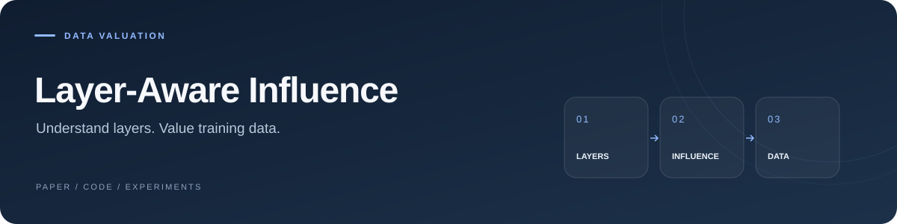

<p align="center">
  
</p>

### Layer-Aware Influence for Online Data Valuation Estimation

**Ziao Yang**, Longbo Huang, and Hongfu Liu

**[PDF](https://arxiv.org/pdf/2510.16007)** · **[Paper](https://arxiv.org/abs/2510.16007)** · **[Explore code](#explore-the-experiments)**

---

Layer-aware influence estimation for online training-data valuation, with experiment implementations for GPU and TPU workflows.

## Explore the experiments

| Task | Code |
| :--- | :--- |
| Language-model training | [`GPT-Neo/`](GPT-Neo/) |
| TPU training and data curation | [`DBC_tpu/`](DBC_tpu/) |
| GLUE tasks | [`GLUE/`](GLUE/) |
| Emotion and 20 Newsgroups | [`Emotion_20News/`](Emotion_20News/) |

## Start here

```bash
git clone https://github.com/yangziao56/Layer-Aware-Influence.git
cd Layer-Aware-Influence
```

- **Training:** follow [`GPT-Neo/gpt-neo.py`](GPT-Neo/gpt-neo.py) and its custom [`ghost_trainer.py`](GPT-Neo/ghost_trainer.py).
- **Task evaluation:** browse [`GLUE/evaluation_single_task_ours.py`](GLUE/evaluation_single_task_ours.py) and [`GLUE/my_trainer.py`](GLUE/my_trainer.py).
- **TPU experiments:** begin with [`DBC_tpu/gpt-neo.py`](DBC_tpu/gpt-neo.py).

Choose an experiment directory and configure its model, data, and output paths for your environment.

---

<details>
<summary><strong>Citation</strong></summary>

```bibtex
@misc{yang2025layer,
  title = {Layer-Aware Influence for Online Data Valuation Estimation},
  author = {Yang, Ziao and Huang, Longbo and Liu, Hongfu},
  year = {2025},
  eprint = {2510.16007},
  archivePrefix = {arXiv},
  url = {https://arxiv.org/abs/2510.16007}
}
```

</details>
